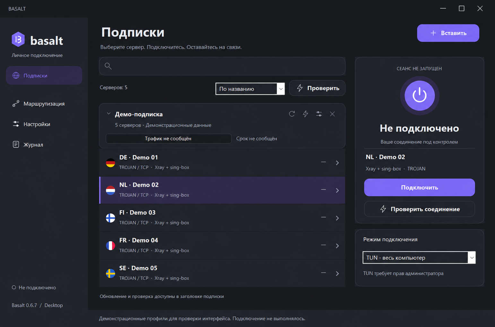

<div align="center">


# Basalt
### Modern tunnels. A home for older Windows.

**Two modern cores · .NET Framework 4.0 · older Windows · x64 & x86**

Basalt is a modern desktop VPN client powered by **Xray and sing-box**, built with backward compatibility in mind. It brings current protocols, system-wide tunneling and straightforward connection management to users who still rely on older Windows systems.

[](https://github.com/HilistonGit/Basalt/releases/latest)
[](LICENSE)
[](docs/compatibility.md)
[](#-make-it-yours)

[**Download →**](https://github.com/HilistonGit/Basalt/releases/latest) · [**Русский README**](README.ru.md) · [Report an issue](https://github.com/HilistonGit/Basalt/issues)


<sub>Actual application demo screenshot, anonymized with AI. Example servers only; no live account or subscription data.</sub>

</div>

## 🪨 Modern VPN capabilities for Windows you still use

Basalt primarily targets **Windows 8 and 8.1**. Its purpose is to let you use modern VPN protocols without replacing your operating system just to run a client. One interface brings together **Xray and sing-box**, choosing the appropriate core for each profile. Tunnel the whole computer or split traffic using routing rules.

Backward compatibility shapes both layers:

- **A lightweight .NET Framework 4.0 / Windows Forms shell.** No Electron, WebView or embedded browser. This platform keeps even Windows XP within the shell's compatibility ambitions, although Basalt's shell itself has not yet been tested on XP.
- **Modern cores in dedicated legacy builds.** The package includes Xray 26.10.21 and sing-box 1.14.4, built upstream for Windows 7 and newer. **Legacy refers to the target operating system:** modern core versions compiled to run on older Windows. Basalt distributes official legacy releases and verifies their checksums.

> **The shell and VPN cores have different requirements.** Targeting .NET 4.0 does not make the complete package XP-compatible: the bundled cores and TUN do not run on XP. Windows 8/8.1 remain the priority; dedicated testing on those systems is still pending.

## ⚡ Two cores. One desktop client.

- **Xray + sing-box**, selected automatically for each profile. VLESS, Trojan, Shadowsocks and Hysteria2; TCP, WebSocket, gRPC and XHTTP where supported by the core.
- **Real TUN** for system traffic, plus system-proxy and application-proxy modes.
- **Split routing** from Happ, native Xray / sing-box JSON and supported Clash YAML rules. Native routing documents take priority over abbreviated Happ headers.
- **GeoSite / GeoIP and remote rule sets**, downloaded and checked before applying a subscription.
- **Portable packages** for x64 and x86, with pinned official legacy cores and Wintun. No Electron, browser runtime or Node.js.

## ✨ Your subscriptions, front and center

Paste a provider URL with **Ctrl+V**. Browse servers inside their subscription, see quota and expiry when supplied, refresh the group, and test HTTPS availability. Country indicators, search, favorites, latency sorting and a validated JSON outbound editor keep the useful tools close.

## 🌍 Make it yours

A dark interface, tray controls, **English and Russian** with live switching, and a system-language default: Russian on Russian Windows, English otherwise.

**Settings → General** contains language, Windows startup and auto-connect. Startup loads saved profiles from disk, refreshes enabled subscriptions, then connects. Failed or partial refreshes keep the saved servers. Failed automatic connections retry with backoff; a manual disconnect cancels the pending retry.

Windows startup uses a per-user scheduled task with the highest available privileges. Enabling it requires UAC, so an administrator's TUN connection can start at sign-in. Both startup options are off by default. If you move the portable folder, disable and re-enable Windows startup to register the new path.

## 🚀 First connection

1. Download the **full portable ZIP** from [Releases](https://github.com/HilistonGit/Basalt/releases/latest). The universal archive contains x64 and x86 cores; the smaller `-x86` archive is for 32-bit Windows.
2. Extract everything and run `Basalt.exe`. Keep the `cores` folder beside it.
3. Paste your HTTPS subscription. Set a shared User-Agent / HWID policy in **Settings → Subscriptions** if your provider requires it.
4. Select a server and connect. TUN needs administrator privileges.
5. Use **Test connection** to verify HTTPS. Closing the window keeps Basalt in the tray; choose **Exit** there to stop it.

## 🔄 Updates from this repository

**Settings → Updates → Check for updates** reads the latest non-prerelease GitHub Release. Basalt chooses the matching architecture, downloads the archive and verifies its size and **SHA-256** against `SHA256SUMS.txt`.

Installation is deliberate: exit Basalt, unpack the verified ZIP, then start the new version. The running executable is never replaced automatically. Profiles remain encrypted with Windows DPAPI under `%LOCALAPPDATA%\Basalt`. Checksums detect corruption; they are not a separate code-signing identity.

## 🧭 Compatibility, honestly

**Windows 8 / 8.1 are the main target**, not a certification claim. Current testing includes modern Windows, real TUN, DNS, routing, reconnect and both core architectures. Dedicated Windows 8/8.1 VM testing remains necessary. Windows XP is **not supported by the bundled TUN/core stack**.

The shell targets **.NET Framework 4 Full**. The UI is Windows Forms; the core model/configuration layer is separate for future ports. Other OS frontends are not implemented.

Clash support is intentionally bounded: MRS, classical providers, fallback groups/DNS and some advanced directives are rejected instead of silently dropping them. See [compatibility notes](docs/compatibility.md) and [development history](docs/HISTORY.ru.md).

## 🛠 Build & verify

On Windows with PowerShell, Git and the .NET Framework compiler:

```powershell
./scripts/fetch-framework-references.ps1
./scripts/build.ps1
./scripts/fetch-official-cores.ps1
./scripts/package.ps1
```

The build runs model and UI regression tests. Integration tests require downloaded cores; network/TUN tests are explicit opt-ins and must not run alongside an existing VPN. See [release maintenance](docs/RELEASING.md).

## 📜 License & acknowledgements

Basalt's own code is **GPL-3.0-only**, © 2026 HilistonGit. Bundled components retain their own licenses; see [NOTICE.md](NOTICE.md). Releases provide sing-box source with vendored dependencies and Xray source alongside the binary packages.

Inspired by the subscription workflow of Happ, the legacy compatibility work of Throne and the dual-core experience of Obelisk. No affiliation is implied.
